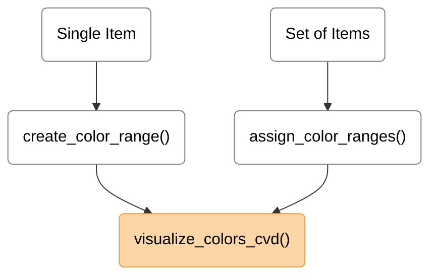
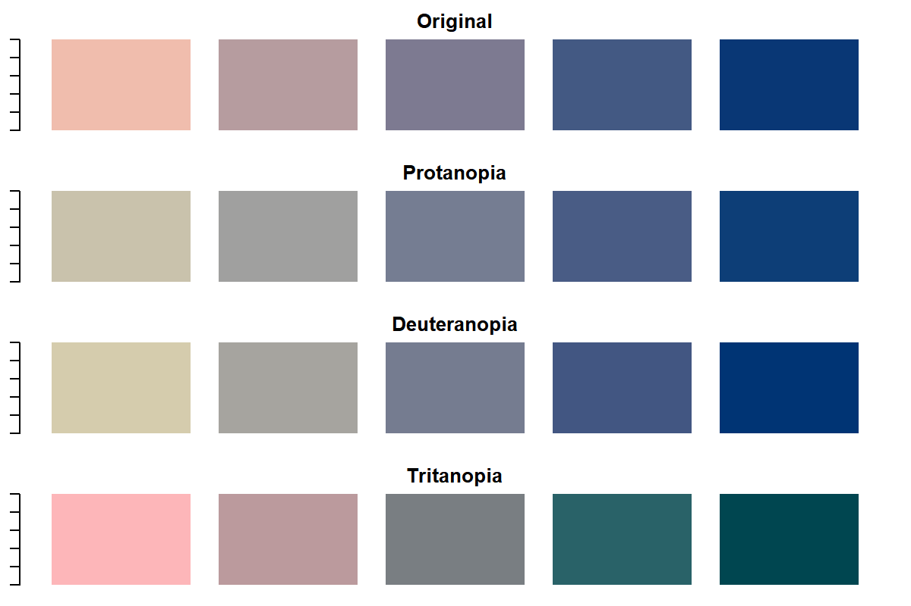

# colorRanges

`colorRanges` provides lightweight tools for generating related color ranges,
assigning these colors to nested categorical data, and visualizing their
appearance under color vision deficiencies. Color generation and CVD simulation
are based on functionality provided by the
[`colorspace`](https://cran.r-project.org/package=colorspace) package.

The package is useful when subcategories belonging to the same broader category
should be represented by related colors.

---

## Installation

You can install the development version of colorRanges from [GitHub](https://github.com/ghostlab-id/colorRanges) with:

```r
# install.packages("remotes")
remotes::install_github("ghostlab-id/colorRanges")
```
---

## Exported functions

| Function                  | Purpose                                        |
| :------------------------ | :--------------------------------------------- |
| `assign_color_ranges()`   | Assign Related Colors to Subcategories         |
| `create_color_range()`    | Create a Color Range Between Two Colors        |
| `visualize_colors_cvd()`  | Visualize Colors Under Color Vision Deficiency |

---

## Workflow



---

## Example

### Single Item

```r
single_item <- create_color_range(c("#F0BDAD", "#093775"), 5)
```

Visualize the assigned colors for each item, incl. visualization for color vision deficiencies (CVDs):
```r
visualize_colors_cvd(color_palette = single_item)
```

<!-- Code used to generate man/figures/cvd-example.png:
  devtools::load_all()
  single_item <- create_color_range(c("#F0BDAD", "#093775"), 5)
  dir.create(file.path(getwd(), "man/figures"), recursive = TRUE, showWarnings = FALSE)
  png(filename = file.path(getwd(), "man/figures/cvd-example.png"), width = 1200, height = 800, res = 200)
  visualize_colors_cvd(color_palette = single_item)
  dev.off() -->




The colors are displayed for four modes of color perception:

- **Original** — original colors without CVD simulation
- **Protanopia** — simulated red–green CVD associated with absent L-cone function
- **Deuteranopia** — simulated red–green CVD associated with absent M-cone function
- **Tritanopia** — simulated blue–yellow CVD associated with absent S-cone function

By default, complete CVD (`cvd_severity = 1`) is simulated. The severity can
be adjusted between `0` (original colors) and `1` (complete simulated CVD).

---

### List of Items

Define a set of variables for selected items:
```r
item_set <- list(
  item1 = c("var1", "var2", "var3"),
  item2 = c("varA", "varB", "varC", "varD", "varE"))
```

Define color ranges by specifying the endpoint colors for each item:
```r
palettes <- list(
  item1 = c("#FFF7BC", "#D95F0E"),
  item2 = c("#DEEBF7", "#08519C"))
```

Assign colors to each item's variables by interpolation between the specified
endpoints:
```r
item_colors <- assign_color_ranges(item_list = item_set, color_palette = palettes)
```

The assigned colors for each item can be visualized using:
```r
visualize_colors_cvd(color_palette=item_colors[["item1"]])
visualize_colors_cvd(color_palette=item_colors[["item2"]])
```
