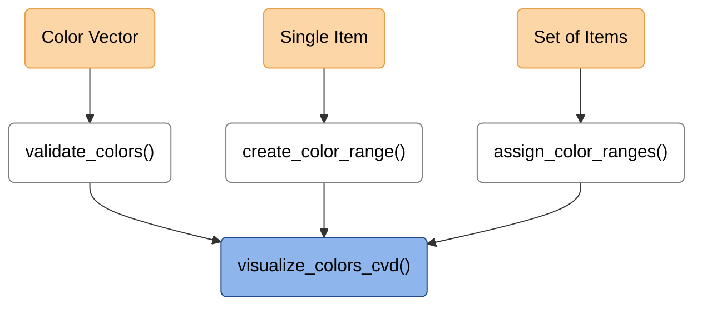
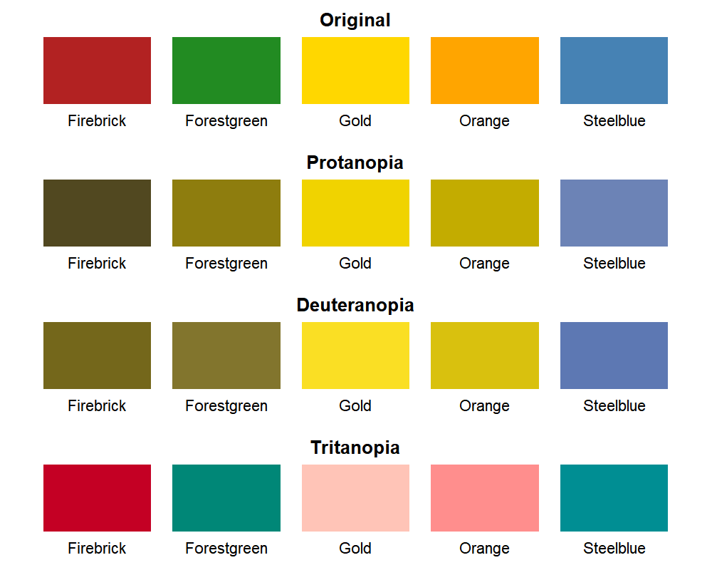
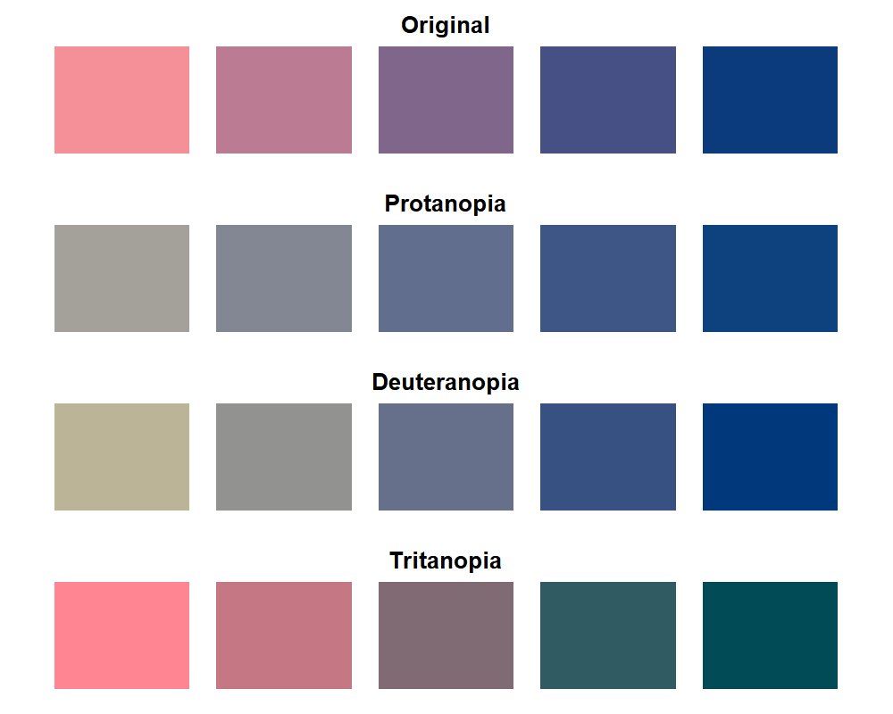

# colorRanges

`colorRanges` provides lightweight tools for generating related color
ranges, assigning these colors to nested categorical data, and
visualizing their appearance under color vision deficiencies. Color
generation and CVD simulation are based on functionality provided by the
[`colorspace`](https://cran.r-project.org/package=colorspace) package.

The package is useful when subcategories belonging to the same broader
category should be represented by related colors.

------------------------------------------------------------------------

## Installation

You can install the development version of colorRanges from
[GitHub](https://github.com/ghostlab-id/colorRanges) with:

``` r
# install.packages("remotes")
remotes::install_github("ghostlab-id/colorRanges")
```

Alternatively, `devtools` can be used for installation.

------------------------------------------------------------------------

## Exported functions

| Function                 | Purpose                                        |
|:-------------------------|:-----------------------------------------------|
| `assign_color_ranges()`  | Assign Related Colors to Subcategories         |
| `create_color_range()`   | Create a Color Range Between Two Colors        |
| `validate_colors()`      | Validate a Color Vector                        |
| `visualize_colors_cvd()` | Visualize Colors Under Color Vision Deficiency |

------------------------------------------------------------------------

## Workflow



**Workflow interpretation:** Light-orange nodes represent the supported
input types, while white nodes indicate the corresponding functions for
color validation, range generation, and assignment. All three workflows
can optionally proceed to the blue node for visualizing the resulting
colors under simulated color vision deficiencies.

------------------------------------------------------------------------

## Example

### Color Vector Validation

Define an, optionally named, color vector:

``` r
named_vector <- c(
  Firebrick = "firebrick",
  Forestgreen = "forestgreen",
  Gold = "gold",
  Orange = "orange",
  Steelblue = "steelblue")
```

Validate and convert color entries into hex codes:

``` r
named_vector <- validate_colors(color = named_vector)
```

Visualize each color, incl. visualization for color vision deficiencies
(CVDs):

``` r
visualize_colors_cvd(color_palette = named_vector)
```

<!-- Code used to generate man/figures/cvd-color-vector.png:
  devtools::load_all()
  named_vector <- c(
    Firebrick = "firebrick",
    Forestgreen = "forestgreen",
    Gold = "gold",
    Orange = "orange",
    Steelblue = "steelblue")
  named_vector <- validate_colors(color = named_vector)  
  dir.create(file.path(getwd(), "man/figures"), recursive = TRUE, showWarnings = FALSE)
  png(filename = file.path(getwd(), "man/figures/cvd-color-vector.png"), width = 1000, height = 800, res = 200)
  visualize_colors_cvd(color_palette = named_vector)
  dev.off() -->



The colors are displayed for four modes of color perception:

- **Original** — original colors without CVD simulation
- **Protanopia** — simulated red–green CVD associated with absent L-cone
  function
- **Deuteranopia** — simulated red–green CVD associated with absent
  M-cone function
- **Tritanopia** — simulated blue–yellow CVD associated with absent
  S-cone function

By default, complete CVD (`cvd_severity = 1`) is simulated. The severity
can be adjusted between `0` (original colors) and `1` (complete
simulated CVD).

------------------------------------------------------------------------

### Single Item

We can create a color vector of length `n` using the endpoints as
defined by `color_palette`:

``` r
single_item <- create_color_range(color_palette=c("#F59099", "#0B3B7D"), n=5)
```

Visualize each color, incl. visualization for color vision deficiencies
(CVDs):

``` r
visualize_colors_cvd(color_palette = single_item)
```

<!-- Code used to generate man/figures/cvd-single-item.png:
  devtools::load_all()
  single_item <- create_color_range(color_palette=c("#F59099", "#0B3B7D"), n=5)
  dir.create(file.path(getwd(), "man/figures"), recursive = TRUE, showWarnings = FALSE)
  png(filename = file.path(getwd(), "man/figures/cvd-single-item.png"), width = 1000, height = 800, res = 200)
  visualize_colors_cvd(color_palette = single_item)
  dev.off() -->



------------------------------------------------------------------------

### List of Items

Define a set of variables for selected items:

``` r
item_set <- list(
  item1 = c("var1", "var2", "var3"),
  item2 = c("varA", "varB", "varC", "varD", "varE"))
```

Define color ranges by specifying the endpoint colors for each item:

``` r
palettes <- list(
  item1 = c("#FFF7BC", "#D95F0E"),
  item2 = c("#DEEBF7", "#08519C"))
```

Assign colors to each item’s variables by interpolation between the
specified endpoints:

``` r
item_colors <- assign_color_ranges(item_list = item_set, color_palette = palettes)
```

The assigned colors for each item can be visualized using:

``` r
visualize_colors_cvd(color_palette=item_colors[["item1"]])
visualize_colors_cvd(color_palette=item_colors[["item2"]])
```

To omit the color labels for a named color vector in the visualization,
set `show_names=FALSE`.

------------------------------------------------------------------------

## Citation

If you use `colorRanges` in published work, please cite the package as
well as the
[`colorspace`](https://CRAN.R-project.org/package=colorspace) package,
which provides the underlying color-space and color vision deficiency
functionality.

Package citation information is available in R using:

``` r
citation("colorRanges")
citation("colorspace")
```

Alternatively, the citation for `colorRanges` and `colorspace` can be
copied below.

**colorRanges**

    Spies E (2026). "colorRanges: Create and Evaluate Color Ranges for Nested Categories." R package version 0.1.0.

**colorspace**

    Zeileis A, Fisher JC, Hornik K, Ihaka R, McWhite CD, Murrell P, Stauffer R, Wilke CO (2020). "colorspace: A Toolbox for Manipulating and Assessing Colors and Palettes." Journal of Statistical Software, 96(1), 1–49. doi:10.18637/jss.v096.i01.
